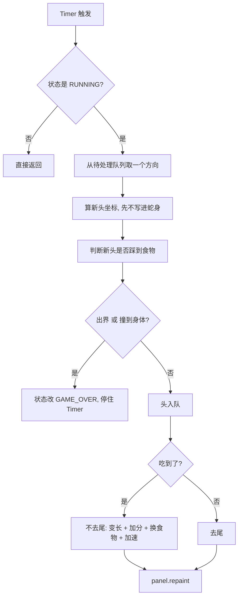
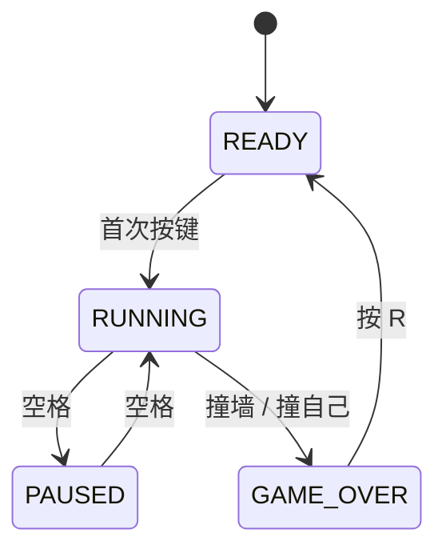

# Snake

用 Java + Swing 写的贪吃蛇。目标是结构清楚、每一步都能运行、逻辑层可以脱离界面单独验证。

零第三方依赖，不需要 Maven / Gradle，用 IDEA 直接编译运行。

---

## 一、架构定位

这套结构**不是标准 MVC**，而是 **Model-View-Loop（拉取式）**，可以看成一个简化过的 MVP 变体。

差别只有一处，但很关键：

- **标准 MVC**：Model 状态变化时主动通知 View（Observer 推送），View 被动刷新。
- **本项目**：`Timer` 每 120ms 调一次 `model.step()`，然后 `panel.repaint()`；View 在 `paintComponent` 里主动从 Model 读一份快照。

方向正好相反——一个是 push，一个是 pull。

不采用 MVC 的原因：贪吃蛇每帧状态都在变，"状态变了再通知"没有收益，反而多出一条 `Model → View 接口` 的反向依赖，会让 Model 无法脱离界面独立测试。游戏是持续演化的，不是事件响应的，主循环驱动更贴合。

### 三条必须守住的依赖规则

1. **`model` 不 import 任何 `java.awt` / `javax.swing`**，不持有 `Timer`，不读写文件。
2. **`view` 单向读 `model`**，只调 getter，绝不调任何改状态的方法。
3. **`loop` 是唯一同时认识两边的角色**，跨层的调度只能由它做。

### 怎么验证结构没走样

> **把 `view` 和 `loop` 两个包整个删掉，`model` 还能编译通过吗？**

能 → 结构是真的；不能 → 说明逻辑层里混进了界面依赖，包名只是看着像。

---

## 二、系统工作流程

### 2.1 启动

`Main` 在 EDT 上完成装配，之后**再没有人主动调逻辑**——所有推进都由时钟驱动。

```
new GameModel() → new GamePanel(model) → new GameLoop(model, panel)
                → new InputHandler(panel, model, loop) → loop.start()
```

这意味着：没人按键，蛇照样往前爬。玩家不驱动游戏，只改变游戏的方向。

### 2.2 一个 tick 做什么



**第 4 步和第 5 步的顺序是这个流程里唯一的陷阱。**

必须先确定"吃没吃到"，才能判断"尾巴这一 tick 会不会移走"，进而才能判断"头撞到的那个格子算不算身体"。顺序反了会出现两个 bug：

- 长蛇贴着自己尾巴转弯时被误判死亡；
- 已经撞死了却还加了分。

### 2.3 绘制发生在什么时候

`repaint()` 只是往 EDT 事件队列里贴一个标记，同一轮里的多次调用会被合并成一次真正的 `paintComponent`。所以 tick 里放心调，不会造成重绘风暴。

`paintComponent` 内部顺序：背景 → 网格 → 食物 → 蛇身（从头到尾）→ 蛇头单独配色 → 覆盖层（暂停 / 结束）。

### 2.4 输入插在哪里

输入发生在 tick 与 tick **之间**。玩家一秒能按五六次，而蛇一秒只走八格，所以"按一次键"不等于"走一步"。

`InputHandler` 只做翻译：按键 → `model.requestDirection(dir)`。方向进入待处理队列，**每个 tick 消费一个**。这样连按两次也不会互相覆盖。

### 2.5 状态流转



谁有权改状态，必须分清：

| 转移 | 责任人 |
|---|---|
| `READY → RUNNING` | `Main` 或 `InputHandler` |
| `RUNNING ⇄ PAUSED` | `InputHandler`（同时 stop/start Timer） |
| `RUNNING → GAME_OVER` | **只有 `GameModel.step()`** |
| `GAME_OVER → READY` | `InputHandler` 调 `model.reset()` |

### 2.6 线程模型

键盘事件、`Timer` 回调、`paintComponent` 全部在 **EDT 这一条线程**上排队执行，彼此不并发。

所以本项目里**没有任何锁**，也不需要 `volatile` / `synchronized`。代价是：`step()` 里绝对不能有耗时操作，否则界面直接卡住——重绘排在它后面。

---

## 三、包与类的职责

```
src/main/java
├── model/      纯粹的规则与状态，不认识界面
├── loop/       时钟与装配，唯一横跨两边的人
└── view/       渲染与输入，只读不改
```

### model —— 游戏世界的状态与规则

| 类 | 职责 | 不该出现的 |
|---|---|---|
| `Cell` | 一个格子坐标，不可变值对象。用 record 自动获得 `equals` / `hashCode` | 任何 `static` 字段 |
| `Direction` | 四个方向 + `dx/dy` + 反向判断 | 越界判断（那是 `Board` 的事） |
| `GameState` | 一局的四个状态：`READY` / `RUNNING` / `PAUSED` / `GAME_OVER` | 任何逻辑 |
| `Board` | 边界判定、食物落点、空格收集 | 持有蛇的引用去改蛇、判断"吃到了" |
| `Snake` | 蛇身队列 + 待处理方向队列 | 撞墙判断、吃到判断、胜利判断 |
| `GameModel` | 一局游戏的全部状态，`step()` 是核心 | `Timer`、awt/swing、文件 IO、`repaint` |

`GameModel` 是全项目的心脏，也是最值得先写、先用纯文本验证的一个类。它能脱离窗口跑起来，是这套结构最大的回报。

### loop —— 驱动与装配

| 类 | 职责 | 不该出现的 |
|---|---|---|
| `GameLoop` | 持有 `Timer`，调 `step()` 和 `repaint()`，处理暂停/恢复与速度变化 | 游戏规则判断、直接改 model 字段 |
| `Main` | 建窗口、装配对象、启动。30 行以内 | 任何游戏逻辑 |

用 `javax.swing.Timer` 而不是自己开线程，原因就是 2.6 说的：回调在 EDT 上，天然无锁。

### view —— 渲染与输入

| 类 | 职责 | 不该出现的 |
|---|---|---|
| `GamePanel` | `paintComponent` 画格子、蛇、食物、覆盖层 | 任何 setter、任何"该不该结束"的判断 |
| `InputHandler` | 按键翻译成 model 的意图 | 任何规则校验（反向不合法等） |

一个容易被忽略的原则：**校验放 model，翻译放 view**。"这个方向合不合法"是规则，属于 `GameModel` / `Snake`；`InputHandler` 只负责把 `KeyEvent` 变成 `Direction`。这样规则才能被单元测试覆盖，界面换了也不用重写。

---

## 四、建议的编写顺序

原则：**沿依赖方向自底向上，每完成一步都能编译、都能看到变化。**

| 步骤 | 写什么 | 里程碑 |
|---|---|---|
| 1 | `Cell`、`Direction`、`GameState` | 三个叶子类，编译通过 |
| 2 | `Board` | 能问"在不在界内"、"给我一个空格" |
| 3 | `Snake` | 能问"头在哪"、"这格被占了没" |
| 4 | `GameModel.step()` | **先不碰界面**，在 `main` 里循环调用并打印坐标 |
| 5 | `GamePanel.paintComponent` | 屏幕上出现一条静止的蛇 |
| 6 | `GameLoop` | 蛇自己会爬了 |
| 7 | `InputHandler` | 能转弯了 |
| 8 | `Main` | 完整的一局 |

两个顺序上的理由：

- **`GamePanel` 必须在 `GameModel` 之后**：绘制要调 model 的 getter，getter 定不下来就没法写。依赖方向决定编写方向。
- **`GameLoop` 必须在 `GamePanel` 之后**：先有静止画面再有动画。反着来，"蛇不动"时你分不清是渲染错了还是时钟没触发。**一次只引入一个新变量**，这是调试最有效的习惯。

---

## 五、运行与打包

**运行**：IDEA 里直接跑 `loop.Main`，不需要构建工具。

**打包成可执行 jar**（JDK 自带，不用手写 `MANIFEST.MF`）：

```bash
jar --create --file snake.jar --main-class loop.Main -C out/production/Snake .
```

**为什么不引入 Maven**：本项目零第三方依赖，构建结果也不需要复现，Maven 解决的两个问题这里都不存在。等真的需要第三方库、需要上 CI、或拆成多模块时再加，那时只需补一个 `pom.xml`，目录布局（`src/main/java`）本来就是 Maven 的形状，不需要迁移文件。

---

## 六、这一版不做的

排行榜、皮肤、音效、关卡、存档、移动端适配。

先把"能玩"做出来，再加这些。反过来做的项目，通常是两个月后手上还没有一个能跑的版本。

---

## 七、写完这一版留下的经验

这些不是贪吃蛇专属，换任何小项目都成立。类顶部的注释只留了跟本类直接相关的部分，通则收在这里。

**关于状态**

1. **能算出来的就别存。** 蛇的长度是 `body.size()`，是否通关是 `length == width * height`。缓存它们只多出几个必须同步的写入点，漏一处就出现"吃了食物没变长"且不报错。
2. **推不出来的才配当字段。** 食物坐标推不出来，所以它必须存；并且只能有一个写入点（`spawnFood`）。单一数据源一旦被打破，表现是"画的和判定的不是同一个东西"。
3. **同一个事实不要存两份。** 暂停与否只有 `GameState` 说了算，`GameLoop` 里再存一个 `paused` 就是两个真相。

**关于 Java**

4. **`final` 锁的是引用，不是内容。** `private final ArrayDeque<Cell> body` 不能重新赋值，但 `offerFirst` / `pollLast` / `clear` 全都合法。所以 `reset()` 用 `clear()`，不要 `new` 一个新队列。
5. **不可变的值对象让你省掉防御性拷贝。** `Cell` 是 record、`Direction` 是枚举，返回时直接给引用就行；只有可变集合（`body`）必须拷贝后再交出去。
6. **`record` 的 `equals` 是判定的地基。** "这个格子是不是食物""蛇头撞到的是不是身体"，全靠坐标相等。换成普通 class 又忘了重写 `equals`，就会永远判不相等。

**关于驱动方式**

7. **游戏是时钟驱动，不是事件驱动。** `Timer` 每 120ms 调一次 `step()`，没人按键蛇也照样爬。玩家改的不是"这一帧走不走"，而是"下一步往哪走"。
8. **输入要缓冲，不要覆盖。** 按键存进 `pending` 队列，每个 tick 消费一个——因为合法的掉头需要两次转向，而它们常常挤在同一个 tick 间隔里。
9. **顺序就是正确性。** `step()` 里"判食物"必须在"判死活"之前，否则不知道尾巴会不会让位。这类顺序错误手玩几十分钟都不一定撞上。
10. **一次只引入一个新变量。** 先有静止的画面，再有会动的蛇；先能走，再能转弯。出问题时你才知道该怀疑谁。

**关于注释和测试**

11. **注释解释"为什么"，代码说明"是什么"。** 每多一行注释就多一份维护成本，所以类顶部只留三样：这个类干什么、字段和方法各是什么、值得记住的坑。
12. **测试按行为组织，不按类组织。** 一个文件里放多个用例，每个用例自己造对象、自己断言。它们的价值不在第一次跑通，而在第十次改代码时替你盯着边界。
