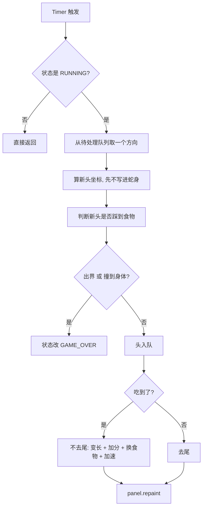
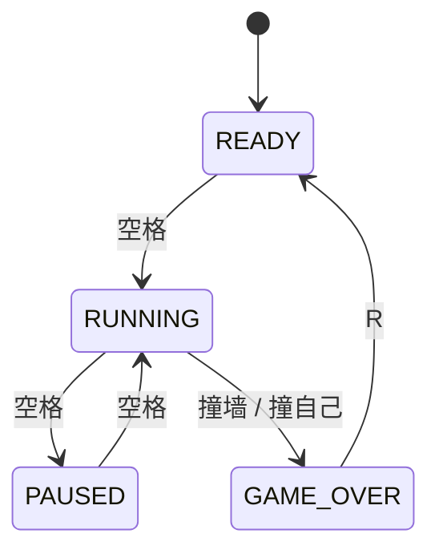

# 贪吃蛇 · Java + Swing

从零手写的贪吃蛇。零第三方依赖、不用构建工具，JDK 21 直接编译运行。

结构上故意拆成三层：**规则**（`model`）、**时钟**（`loop`）、**画面与按键**（`view`）。
这样游戏逻辑能脱离窗口单独运行、单独测试 —— 这是整个项目最重要的一条设计选择。

- 想玩：[一、怎么玩](#一怎么玩) → [二、运行](#二运行)
- 想看代码：[三、结构](#三结构为什么不是-mvc) → [四、开发过程](#四开发过程按实际顺序) → [五、踩过的坑](#五踩过的坑症状--原因--解法)
- 只要结论：[六、经验](#六经验可迁移的)

当前版本 `v0.1.0`。

---

## 一、怎么玩

### 规则

吃食物变长，越吃越快；撞墙或撞到自己结束。棋盘 27×27 格，开局一条 3 节的蛇朝右。

| 事件 | 结果 |
|---|---|
| 吃到一个食物 | +10 分，蛇长 +1，每格间隔 −5ms |
| 初始 / 最快速度 | 150ms 一格 → 最快 70ms 一格 |
| 撞墙、撞到自己 | 游戏结束，显示最终得分，按 R 可以重来 |

### 按键

| 键 | 作用 |
|---|---|
| ↑ 或 W | 向上 |
| ↓ 或 S | 向下 |
| ← 或 A | 向左 |
| → 或 D | 向右 |
| 空格 | 开始 / 暂停 / 继续 |
| R | 重新开始（退回"按空格开始"） |

三个容易误会的地方：

- **反向键被忽略**（正向右时按 ← 无效）。这是规则，不是失灵。
- **按键会排队，不是立刻生效**。人一秒能按五六次，蛇一秒只走六七格，所以方向先进入一个长度 2 的队列，每个 tick 消费一个。想掉头要先按上/下再按反方向，这个"两步"必须挤在两个 tick 之间。
- **打开窗口就能按键**，不用先点一下画布；中文输入法开着也不影响，程序里关掉了输入法。

### 画面

蓝色圆点 = 蛇头，绿色 = 蛇身，黄色 = 食物，右上角是分数。
`READY` / `PAUSED` / `GAME_OVER` 时整屏蒙一层半透明黑，中间写字。

---

## 二、运行

**环境**：JDK 21 或更高。没有 Maven / Gradle，也没有任何 jar 依赖。

### IDEA

打开项目，运行 `loop.Main` 即可。源码根是 `src/main/java`，测试根是 `src/test/java`。

### 命令行

```powershell
# 编译到 out
javac -encoding UTF-8 -d out (Get-ChildItem -Recurse src/main/java -Filter *.java).FullName
java -cp out loop.Main
```

### 跑测试

测试不依赖 JUnit，就是两个带 `main` 的类，直接跑：

```powershell
javac -encoding UTF-8 -cp out -d out-test (Get-ChildItem -Recurse src/test/java -Filter *.java).FullName
java -cp "out;out-test" model.SnakeTest
java -cp "out;out-test" model.GameModelTest
```

### 打包成可执行 jar

```powershell
jar --create --file snake-0.1.0.jar --main-class loop.Main -C out .
java -jar snake-0.1.0.jar
```

`--main-class` 会替你写 `MANIFEST.MF`，不需要手写。

---

## 三、结构：为什么不是 MVC

这套结构是 **Model-View-Loop（拉取式）**，可以看成简化版的 MVP。

差别只有一处，但决定了整个项目的写法：

- **标准 MVC**：model 状态变了主动通知 view（push），view 被动刷新。
- **本项目**：`Timer` 每个 tick 调一次 `model.step()`，然后 `panel.repaint()`；view 在 `paintComponent` 里自己进 model 读快照（pull）。

不选 MVC 的原因：贪吃蛇每帧都在变，"变了再通知"没有收益，反而多一条 `model → view 接口` 的反向依赖，model 就没法脱离界面测试了。游戏是时钟驱动的，不是事件响应的。

```
        loop  ──────→  model
          │              │
          ↓              │ 只读
        view  ───────────┘
```

### 三条依赖铁律

1. `model` 不 import 任何 `java.awt` / `javax.swing`，不持有 Timer，不读写文件。
2. `view` 单向读 `model`，只调查询方法，一个写方法都不碰。
3. `loop` 是唯一同时认识两边的角色，跨层调度只发生在它这里。

**验证方法**：把 `view` 和 `loop` 两个包整个删掉，`model` 还能编译通过吗？能，结构就是真的；不能，说明逻辑层里混进了界面依赖，包名只是看着像。

### 十个类各干什么

| 包 | 类 | 职责 | 不该出现的东西 |
|---|---|---|---|
| `model` | `Cell` | 格子坐标，record，天然有 `equals` | 任何 static 字段 |
| | `Direction` | 四个方向 + `dx/dy` + 反向判断 | 越界判断 |
| | `GameState` | 四态枚举 | 任何逻辑 |
| | `Board` | 边界、食物落点、空格收集 | 改蛇、判断"吃到了" |
| | `Snake` | 身体队列 + 待处理方向队列 | 撞墙、吃到、赢输 |
| | `GameModel` | 一局的状态，`step()` 是核心 | Timer、awt/swing、文件 |
| `loop` | `GameLoop` | 持有 Timer，调 `step()` 和 `repaint()` | 游戏规则 |
| | `Main` | 建窗口、装配、启动 | 任何逻辑 |
| `view` | `GamePanel` | `paintComponent` 画所有东西 | 任何 setter、任何规则判断 |
| | `InputHandler` | 按键翻译成对 model 的调用 | 反向校验等规则 |

### 一个 tick 做什么



**第 4、5 步的顺序是整个项目唯一的硬约束**：必须先知道"吃没吃到"，才能知道"尾巴这一 tick 会不会移走"，进而才能判断"头未来的位置算不算撞到自己"。顺序反了会出现两个 bug：长蛇贴着自己尾巴转弯被误判死亡、已经撞死了还加分。这两个都不会报错，也不容易手玩出来。

### 状态流转



| 转移 | 由谁触发 |
|---|---|
| `READY → RUNNING` | `InputHandler` 调 `model.start()` |
| `RUNNING ⇄ PAUSED` | `InputHandler` 调 `model.togglePause()` |
| `RUNNING → GAME_OVER` | 只有 `GameModel.step()` |
| `GAME_OVER → READY` | `InputHandler` 调 `model.reset()` |

暂停不靠停时钟：`step()` 第一行就是"不是 RUNNING 就返回"，所以时钟一直转、`step()` 什么都不干，效果和停表一样，还少一个必须同步的状态。

### 线程

键盘事件、Timer 回调、`paintComponent` 全在 **EDT 一条线程**上排队，彼此不并发。
所以整个项目**没有一把锁**，也没有 `volatile` / `synchronized`。代价是 `step()` 里不能有耗时操作 —— 它卡多久，界面就冻多久。

---

## 四、开发过程（按实际顺序）

| 阶段 | 做了什么 | 得到的判断 |
|---|---|---|
| 1 定范围 | 单机、一局、键盘，不做排行榜/存档/联网 | 范围越小，越容易在两周内看到能跑的版本 |
| 2 选技术 | Java + Swing（JDK 自带），不引 Maven | 零第三方依赖时，构建工具只是在多一个配置面 |
| 3 定结构 | 先定三个包，再列十个类各一句话职责 | 包的边界比类的细节重要，先吵清楚谁依赖谁 |
| 4 打通最小闭环 | 先让 `model` 在 `main` 里打印坐标跑通，再画面，再时钟，再按键 | 每一步都能运行，出错时改动范围只有刚写的那一块 |
| 5 验证 | 自写 `expect(期望, 实际, 说明)`，不引 JUnit | 6 个用例就能抓住大部分边界，比搭测试框架快 |
| 6 收尾 | 注释、README、打包、git 提交与 tag | 文档写"为什么"，代码写"是什么" |

### 写代码的顺序

和依赖方向一致，自底向上：

```
Cell / Direction / GameState → Board → Snake → GameModel.step()
→ GamePanel → GameLoop → InputHandler → Main
```

两个顺序上的理由：

- **依赖方向决定编写方向**：`GamePanel` 要调 model 的查询方法，那些方法定不下来就没法画。
- **一次只引入一个新变量**：先有静止画面再有动画。反着来，"蛇不动"时你分不清是画面错了还是时钟没触发。

### 几个当时纠结过的决定

| 决定 | 结论 | 理由 |
|---|---|---|
| 要不要 Maven | 不要 | 零依赖、不需要复现构建；目录本来就是 Maven 形状，以后要加只补一个 `pom.xml` |
| `Main` 要不要 `extends JFrame` | 不要 | 继承会把启动拆成构造器 + `main` 两段，中间得用字段把对象传过去；不继承就一个方法到底，顺序即执行顺序 |
| 键盘用 `KeyListener` 还是 `InputMap` | `InputMap` | `KeyListener` 要求组件先拿到焦点，失焦复焦后的行为很难预测 |
| 暂停要不要 `timer.stop()` | 不要 | 状态已经在 model 里，再停表就是两个真相 |
| 要不要画网格 | 默认不画 | 蛇身每节留 1px 缝就够分段了，30 条线只会让画面变吵 |

---

## 五、踩过的坑（症状 → 原因 → 解法）

这些都是实际撞上的，共同点是**不报错、不抛异常，只是"看起来不对"**。

| 症状 | 原因 | 解法 |
|---|---|---|
| 窗口一片纯色，什么都不画 | 忘了 `extends JPanel`；或 `paintComponent(Graphics2D g)` 写成了重载 | 参数保持 `Graphics`，靠 `@Override` 兜底 |
| 窗口缩成一条标题栏 | 没重写 `getPreferredSize`，默认接近 0×0 | 返回 `board 尺寸 × CELL_SIZE` |
| 蛇挤在左上角几个像素里 | 格子坐标直接当像素用了 | 所有绘制统一走 `toPixel` |
| 食物外圈有一道黑边 | `drawOval` 写在 `setColor` 之前，用的是上一次的颜色 | 只留 `fillOval`，不描边 |
| 开局同时显示"按空格开始"和"游戏结束" | `switch` 冒号形式没写 `break`，分支穿透 | 用箭头 `switch`，从根上没有穿透 |
| 所有按键都没反应（英文输入法也是） | `getInputMap()` 无参版等于 `WHEN_FOCUSED` | `getInputMap(WHEN_IN_FOCUSED_WINDOW)` |
| 中文输入法下按键全失灵 | 按键先交给输入法判断要不要消费，方向键去选候选词了 | `enableInputMethods(false)` + `setFocusable(true)` + 显示后 `requestFocusInWindow()` |
| 某一个键单独不响应 | `getKeyStroke("up")` 解析失败返回 `null`，`put(null, …)` 静默失效 | 字符串名必须大写，或用 `KeyEvent.VK_*` |
| 蛇慢半拍，按键后要等一下才转向 | tick 里 `repaint()` 写在 `step()` 之前，画的永远是上一帧 | 顺序：`setDelay` → `step` → `repaint` |
| 点了叉窗口没了，进程还在 | `JFrame` 默认 `HIDE_ON_CLOSE`，EDT 还活着 | `setDefaultCloseOperation(EXIT_ON_CLOSE)` |
| 一运行就假死、键盘无响应 | `delayMillis` 还是 0，`Timer(0, …)` 连续不停触发 | 构造器里给它初值（150） |
| 长蛇贴着自己尾巴转弯时被判死 | 先判死活、后判食物，不知道尾巴会不会让位 | 顺序对调，并把 `willGrow` 传给 `hitSelf` |
| 拖动窗口时蛇瞬移十几格 | 在 `paintComponent` 里调了 `step()` | 绘制只读，逻辑只在 tick 里 |
| 跨包编译不过 `cannot find symbol` | `model` 的构造器和方法还是包级私有 | `model` 的 `public` 集合就是它对外 API，要一个个想清楚 |
| 一帧里 `body()` 被拷贝三十次 | 在循环条件里反复调 `body()`，而它每次都 `List.copyOf` | 循环外取一次存局部变量 |

---

## 六、经验（可迁移的）

**关于状态**

1. **能算出来的就别存。** 蛇长就是 `body.size()`。缓存它只会多出"吃食物 / 去尾 / reset"三处必须同步的写入点，漏一处就是"吃了食物没变长"。
2. **推不出来的才配当字段，而且只给它一个写入点。** 食物坐标推不出来，所以必须存；只能由 `spawnFood` 写。一旦有两个写入点，画的和判定的就不是同一个东西了。
3. **同一个事实不要存两份。** 暂停只由 `GameState` 说了算，`GameLoop` 里再来个 `paused` 就是两个真相。

**关于 Java**

4. **`final` 锁的是引用，不是内容。** `private final ArrayDeque<Cell> body` 不能重新赋值，但 `addFirst` / `pollLast` / `clear` 全都合法 —— 所以 `reset()` 用 `clear()`，不 `new`。
5. **不可变对象让你省掉防御性拷贝。** `Cell` 是 record、`Direction` 是枚举，直接给引用；只有可变集合（`body`）必须拷贝后再交出去。
6. **`record` 的 `equals` 是全部判定的地基。** 换成普通 class 又忘了重写，就会"坐标明明一样却判不相等"，而且看起来像是逻辑写错了。

**关于驱动方式**

7. **游戏是时钟驱动，不是事件驱动。** 没人按键蛇也照样爬，玩家改的不是"这一帧走不走"，而是"下一步往哪走"。
8. **输入要缓冲，不要覆盖。** 按键进队列、每 tick 消费一个 —— 因为合法掉头需要两次转向，而它们常常挤在同一个 tick 间隔里。
9. **顺序就是正确性。** "判食物在判死活之前"、"`step` 在 `repaint` 之前"，这类顺序错了不报错、只是结果不对，手玩几十分钟都未必撞上。

**关于调试**

10. **一次只引入一个新变量。** 先静止画面再动画，先能走再能转。出问题时你才知道该怀疑谁。
11. **静默失败最狠，所以先证明"这段代码被调用了"。** 画面空白时，第一件事是在 `paintComponent` 里打一行日志，而不是读绘制代码。
12. **先怀疑数据，再怀疑绘制。** 画错了有一半概率是 model 的数据本来就错 —— 回到那个不弹窗口的 `main` 里打印一遍，比盯着 `paintComponent` 快。

**关于工程**

13. **注释解释"为什么"，代码说明"是什么"。** 每多一行注释就多一份维护成本：只写"这个类干什么、字段是什么、有什么坑"，别复述代码。
14. **测试按行为组织，不按类组织。** 价值不在第一次跑通，而在第十次改代码时替你盯着边界。

---

## 七、没做的

排行榜（要落盘，等于把 IO 带进 model）、音效、皮肤、难度选择、移动端。

另外：棋盘被蛇占满时 `food` 会变成 `null`（画面上不再出现食物），但**目前没有通关判定**，蛇会继续走直到撞墙。真要做"通关"，该加的是 `GameState` 的第五个值，而不是在 view 里判断 `food == null`。

---

## 八、目录

```
Snake/
├── src/main/java
│   ├── model/     Cell, Direction, GameState, Board, Snake, GameModel
│   ├── loop/      GameLoop, Main
│   └── view/      GamePanel, InputHandler
├── src/test/java/model/
│   ├── SnakeTest.java         蛇自身的队列、转向、自撞
│   └── GameModelTest.java     状态流转、tick、吃与死的连锁
└── README.md
```
